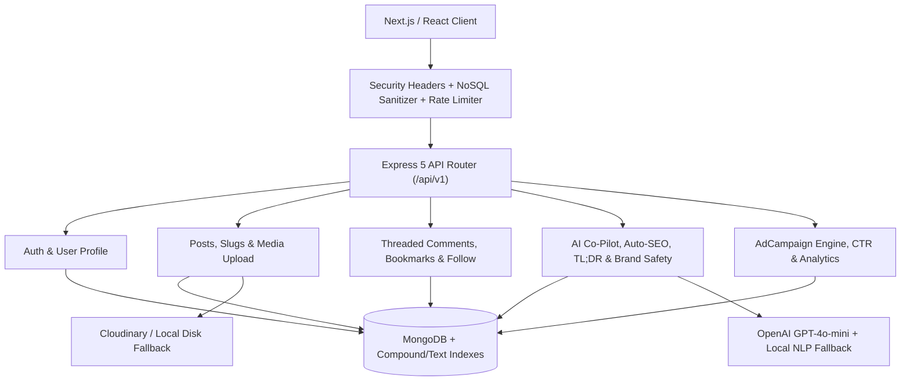

# BuzzBoard Server — AI-Powered Content Publishing & Ad-Tech Monetization API

**BuzzBoard** is a production-ready RESTful backend for modern digital publishing, community engagement, AI editorial workflows, and built-in ad monetization. Engineered with **Node.js, Express 5, MongoDB (Mongoose 8), and OpenAI**, it combines the publishing experience of **Medium/Hashnode** with automated **SEO Intelligence** and an **In-House Ad Campaign & Brand-Safety Engine**.

---

## Key Highlights & Engineering Features

- **AI Co-Pilot & Content Intelligence (`/api/v1/ai`):**
  - **Auto-SEO Metadata Generator:** Automatically generates high-converting title variations, excerpts, SEO `metaDescription` ($\le 160$ chars), URL-safe slugs, and tags from raw drafts.
  - **AI Writing Assistant:** Supports article outline generation, paragraph expansion, grammar polishing, and tone shifting (`professional`, `technical`, `casual`).
  - **1-Click "TL;DR" Reader Summaries:** Generates 3-bullet executive summaries and caches them directly on `Post.aiSummary` to eliminate redundant LLM token costs.
  - **Google AdSense & Brand-Safety Guard:** Automatically evaluates posts against ad-network safety policies (`isAdSafe`, `adSafetyScore`) so unsafe pages never trigger ad-network bans.
- **Built-In Ad-Tech & Monetization Engine (`/api/v1/ads`):**
  - Supports both **Google AdSense** slot configuration and **Direct Sponsored Ad Campaigns** (`header_banner`, `sidebar`, `in_article`, `footer`, `sponsored_post`).
  - Category-targeted ad serving with automatic **Impression tracking**, **Click tracking**, and real-time **CTR (Click-Through Rate)** computation.
- **Community & Retention System (`/api/v1/comments`, `/api/v1/users`):**
  - **Nested Threaded Comments:** Multi-level comment replies (`parentComment`), comment likes, and automatic `Post.commentsCount` synchronization.
  - **Reading List (Bookmarks) & Author Follow Graph:** Users can bookmark articles for later reading, follow authors, and view aggregated public author profiles.
- **Creator & Monetization Analytics (`/api/v1/analytics`, `/api/v1/seo`):**
  - Real-time creator metrics (total views, likes, comments, average engagement rate, top-performing posts, and Ad-Safe readiness percentage).
  - Dynamic **SEO Sitemap API (`/api/v1/seo/sitemap`)** and **Trending Feed (`/api/v1/seo/trending`)** for instant search engine indexing.
- **Production Security & Resilience:**
  - HTTP security headers (`X-Content-Type-Options`, `X-Frame-Options`, `Referrer-Policy`), recursive NoSQL operator injection sanitization, and IP-based rate limiting.
  - Resilient media upload pipeline supporting **Cloudinary** with automatic local disk fallback (`/uploads`).

---

## System Architecture



---

## Project Structure

```text
BuzzBoard-server/
├── src/
│   ├── config/
│   │   ├── cloudinary.js          # Cloudinary v2 configuration
│   │   └── database.js            # MongoDB TLS connection manager
│   ├── controllers/
│   │   ├── adController.js        # Sponsored ad serving, impressions, clicks & CTR
│   │   ├── aiController.js        # Auto-SEO, Writing Co-Pilot, TL;DR & Brand Safety
│   │   ├── analyticsController.js # Creator metrics, revenue stats, Sitemap & Trending
│   │   ├── authController.js      # JWT register, login & profile management
│   │   ├── commentController.js   # Nested threaded comments & comment likes
│   │   ├── postController.js      # Posts CRUD, full-text search, pagination & likes
│   │   └── userController.js      # Bookmarks (Reading list), Follow/Unfollow & Author profile
│   ├── middleware/
│   │   ├── authMiddleware.js      # JWT Bearer protection & RBAC role authorization
│   │   ├── errorMiddleware.js     # Centralized Mongoose & HTTP error formatting
│   │   ├── securityMiddleware.js  # Security headers, NoSQL sanitizer & IP rate limiter
│   │   └── uploadMiddleware.js    # Multer image validation + Cloudinary/Local storage
│   ├── models/
│   │   ├── AdCampaign.js          # Ad placements, targeting, impressions, clicks & CTR
│   │   ├── Comment.js             # Threaded comments schema with parentComment ref
│   │   ├── Post.js                # SEO, AI summary, Ad-Safety & engagement schema
│   │   └── User.js                # User profile, social links, followers & bookmarks
│   ├── routes/
│   │   ├── adRoutes.js
│   │   ├── aiRoutes.js
│   │   ├── analyticsRoutes.js
│   │   ├── authRoutes.js
│   │   ├── commentRoutes.js
│   │   ├── postRoutes.js
│   │   ├── seoRoutes.js
│   │   └── userRoutes.js
│   ├── services/
│   │   └── aiService.js           # OpenAI integration + deterministic NLP fallback engine
│   └── utils/
│       └── generateToken.js       # JWT signing & verification helpers
├── tests/
│   └── api.test.js                # Automated integration test suite across all 5 modules
├── .env.example
├── package.json
└── server.js                      # Application entry point
```

---

## Complete API Reference

| Module | Method | Endpoint | Access | Description |
| :--- | :--- | :--- | :--- | :--- |
| **System** | `GET` | `/api/v1/health` | Public | Server health check & uptime timestamp |
| **System** | `GET` | `/api/v1/docs` | Public | Interactive JSON API endpoint catalog |
| **Auth** | `POST` | `/api/v1/auth/register` | Public | Register a new user account |
| **Auth** | `POST` | `/api/v1/auth/login` | Public | Authenticate user & receive JWT |
| **Auth** | `GET` | `/api/v1/auth/profile` | Private | Get current logged-in user profile |
| **Auth** | `PUT` | `/api/v1/auth/profile` | Private | Update profile, bio, social links, or avatar |
| **Posts** | `GET` | `/api/v1/posts` | Public | List posts with search, category, tag, `adSafeOnly` & pagination |
| **Posts** | `POST` | `/api/v1/posts` | Private | Create post (auto-runs slug, readingTime, SEO & Ad-Safety check) |
| **Posts** | `GET` | `/api/v1/posts/user/my-posts` | Private | Get logged-in creator's draft/published posts |
| **Posts** | `GET` | `/api/v1/posts/:id` | Public | Get single post by `_id` or `slug` (increments view count) |
| **Posts** | `PUT` | `/api/v1/posts/:id` | Private | Update post (author or admin) |
| **Posts** | `DELETE` | `/api/v1/posts/:id` | Private | Delete post & associated cloud media |
| **Posts** | `POST` | `/api/v1/posts/:id/like` | Private | Toggle like/unlike on a post |
| **Posts / AI** | `GET` | `/api/v1/posts/:id/summary` | Public | Get or generate cached 1-Click AI `TL;DR` summary |
| **Comments** | `GET` | `/api/v1/posts/:postId/comments` | Public | Get threaded comments & nested replies for a post |
| **Comments** | `POST` | `/api/v1/posts/:postId/comments` | Private | Create a root comment or nested reply (`parentComment`) |
| **Comments** | `PUT` | `/api/v1/comments/:id` | Private | Edit a comment |
| **Comments** | `DELETE` | `/api/v1/comments/:id` | Private | Delete a comment and its nested replies |
| **Comments** | `POST` | `/api/v1/comments/:id/like` | Private | Toggle like/unlike on a comment |
| **Community** | `GET` | `/api/v1/users/bookmarks` | Private | Get user's saved reading list |
| **Community** | `POST` | `/api/v1/users/bookmarks/:postId` | Private | Toggle bookmark on a post |
| **Community** | `GET` | `/api/v1/users/:id/profile` | Public | Get public author profile, follower stats & published posts |
| **Community** | `POST` | `/api/v1/users/:id/follow` | Private | Follow or unfollow an author |
| **AI Engine** | `POST` | `/api/v1/ai/generate-seo` | Private | Auto-generate SEO titles, excerpt, metaDescription, slug & tags |
| **AI Engine** | `POST` | `/api/v1/ai/assist` | Private | AI Writing Co-Pilot (`outline`, `expand`, `improve`, `grammar`) |
| **AI Engine** | `POST` | `/api/v1/ai/moderate` | Private | Evaluate post for Google AdSense & Brand-Safety compliance |
| **Ad-Tech** | `GET` | `/api/v1/ads/active` | Public | Serve active ads by `placement` & `category` (tracks impressions) |
| **Ad-Tech** | `POST` | `/api/v1/ads/:id/click` | Public | Track ad click, update CTR & return destination URL |
| **Ad-Tech** | `POST` | `/api/v1/ads` | Private | Create a new sponsored ad campaign |
| **Ad-Tech** | `GET` | `/api/v1/ads` | Private | List all ad campaigns with impressions, clicks & CTR |
| **Analytics** | `GET` | `/api/v1/analytics/creator` | Private | Creator dashboard stats, engagement rate & top posts |
| **Analytics** | `GET` | `/api/v1/analytics/monetization` | Private | Platform ad impressions, clicks, average CTR & budget metrics |
| **SEO** | `GET` | `/api/v1/seo/sitemap` | Public | Dynamic sitemap URLs & metadata for Google Search Console |
| **SEO** | `GET` | `/api/v1/seo/trending` | Public | Top trending posts ranked by views and engagement |
| **SEO / RSS** | `GET` | `/api/v1/seo/rss.xml` | Public | RSS 2.0 XML Feed for Google Discover & syndication |
| **SEO / Schema** | `GET` | `/api/v1/posts/:id/schema` | Public | Google Rich Snippet JSON-LD (`BlogPosting`) schema |
| **AI Q&A** | `POST` | `/api/v1/posts/:id/ask` | Public | "Ask AI About This Post" — contextual Q&A for readers |
| **AI Translate** | `POST` | `/api/v1/posts/:id/translate` | Public | 1-Click Bangla (`bn`) $\leftrightarrow$ English (`en`) translation |
| **Discovery** | `GET` | `/api/v1/posts/:id/related` | Public | AI / tag-based related articles recommendation |
| **Reactions** | `POST` | `/api/v1/posts/:id/react` | Private | Multi-reaction / Claps (`love`, `fire`, `insightful`, `clap`) |
| **Notifications** | `GET` | `/api/v1/notifications` | Private | Get user notifications & `unreadCount` |
| **Notifications** | `PATCH` | `/api/v1/notifications/read-all` | Private | Mark all notifications as read |
| **Series** | `GET/POST` | `/api/v1/series` | Public/Private | Create or list multi-part tutorial series |
| **Series** | `GET` | `/api/v1/series/:id` | Public | Get series details with ordered Part 1..N posts |
| **Newsletter** | `POST` | `/api/v1/newsletter/subscribe` | Public | Subscribe to BuzzBoard newsletter by category |

---

## Quick Start & Local Development

### 1. Clone & Install Dependencies
```bash
git clone https://github.com/ashraful2880/BuzzBoard-server.git
cd BuzzBoard-server
npm install
```

### 2. Configure Environment Variables
Copy `.env.example` to `.env` and fill in your credentials:
```bash
cp .env.example .env
```

### 3. Run Automated Integration Tests
```bash
npm test
```

### 4. Start the Server
```bash
# Development mode with hot-reload
npm run dev

# Production mode
npm start
```

---

## Author

**Md Ashraful Islam** — *Senior Frontend & Full-Stack Engineer*
- Portfolio: [ashrafulislam.netlify.app](https://ashrafulislam.netlify.app)
- GitHub: [@ashraful2880](https://github.com/ashraful2880)
- LinkedIn: [linkedin.com/in/islam-ashraful1](https://linkedin.com/in/islam-ashraful1)
